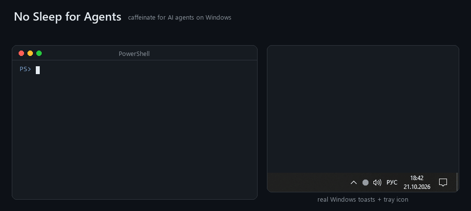

# No Sleep for Agents

[](https://github.com/hellsing123134/nosleep-for-agents/actions/workflows/ci.yml)
[](https://github.com/hellsing123134/nosleep-for-agents/releases/latest)

**caffeinate for AI agents, on Windows.** Close your laptop and let Claude Code / Codex /
OpenCode keep working. When they're done, your laptop goes back to sleeping normally, and
your phone tells you the agent finished or is waiting for your approval.



- 🟠 **Only while agents work.** Watches agent processes *and everything they spawn* (builds,
  tests, servers) plus Claude Code / Codex hooks. Nothing busy → Windows sleeps as usual.
- 💻 **Ignores the lid, then puts it back.** While an agent works, the lid-close action is set
  to "do nothing". Afterwards your own setting comes back, even if nosleep crashed.
- 🔔 **Finished / needs you.** A Windows notification and an optional phone push via
  [ntfy](https://ntfy.sh) when a turn completes or an agent waits for permission.
- 🪫 **Battery guard.** On battery below 20% it steps back and lets the laptop sleep.
- 🪶 **Small.** One ~1.5 MB Rust exe: no installer, no runtime, no telemetry.

## Doesn't Windows already do this?

Partly. You can set **Power Options → "When I close the lid" → Do nothing** (Settings →
Power & battery → Lid & power button controls on Windows 11 24H2+), and PowerToys Awake keeps
the PC from idling to sleep. The catch: both are manual. They stay on until you switch them
back (or until a timer you had to guess runs out). Forget once, and the laptop runs all night
in your bag, hot and draining.

| | lid "Do nothing" | PowerToys Awake | nosleep |
|---|:---:|:---:|:---:|
| keeps working with the lid closed | ✅ | ❌ | ✅ |
| only while an agent is busy, then back to normal | ❌ | ❌ | ✅ |
| tells you when the agent is done or needs you | ❌ | ❌ | ✅ |
| lets go on low battery | ❌ | ❌ | ✅ |

## Install

Grab `nosleep.exe` from the [latest release](https://github.com/hellsing123134/nosleep-for-agents/releases/latest)
and put it anywhere. It isn't code-signed yet, so SmartScreen may ask you to confirm ("More
info → Run anyway"). Or build it yourself:

```bash
cargo install --git https://github.com/hellsing123134/nosleep-for-agents
```

Then run `nosleep` (it lives in the tray) and wire up the hooks once:

```bash
nosleep install-hooks
```

That adds nosleep to `~/.claude/settings.json` (a backup is kept). For Codex it prints the
`notify = [...]` line to put in `~/.codex/config.toml`. Without hooks nosleep still works from
process activity alone, it just can't tell you *why* an agent stopped.

### Phone notifications

Install the ntfy app, subscribe to a long random topic, and put it in
`%APPDATA%\nosleep\config.ini`:

```ini
ntfy_topic = nosleep-7f3a9c1e2b
```

## Tray

The dot tells you the state: 🟠 working · 🔴 waiting for you · 🟡 idle but staying awake (grace
period) · ⚪ sleep allowed. Right-click for **Auto** / **Always awake** / **Off** and the
**Keep working with the lid closed** toggle.

Windows hides new tray icons under the `^` arrow. Drag the dot from there onto the taskbar to
keep it in sight.

## CLI

| command | |
|---|---|
| `nosleep` | run in the tray |
| `nosleep install-hooks` / `uninstall-hooks` | add or remove the Claude Code hooks |
| `nosleep status` | one line: what the running instance is doing |
| `nosleep restore` | put the original lid action back by hand |

## Config

`%APPDATA%\nosleep\config.ini`, created on first run with comments. Highlights:
`agents` (executables to watch), `grace_minutes` (stay awake after the last activity, default 5),
`min_battery`, `notify_after_seconds` (don't announce turns shorter than this), `lid_override`.

## ⚠️ Lid closed, in a bag

A closed laptop working hard in a backpack gets hot. nosleep only holds the lid while agents
are busy plus the grace period, and gives up on low battery, but put it on a desk, not in a bag.

## How it works

See [docs/architecture.md](docs/architecture.md).

## Troubleshooting

Set `NOSLEEP_DEBUG=C:\path\to\log.txt` in the environment your agent runs in, and every hook
payload nosleep receives is appended there.

## License

MIT
